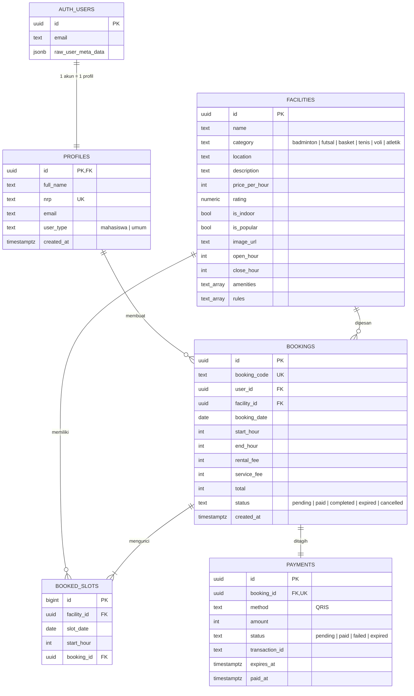

# ERD FasorITS

Diagram Mermaid di bawah dirender otomatis oleh GitHub.

Aturan integritas penting:

- `booked_slots`: `UNIQUE (facility_id, slot_date, start_hour)` mencegah double booking.
- `bookings`: `EXCLUDE` pada (`facility_id`, `booking_date`, rentang `start_hour`..`end_hour`) untuk pesanan aktif.
- Semua foreign key ke `bookings`/`profiles` memakai `ON DELETE CASCADE` (dasar fitur hapus akun dan batal pesanan).
